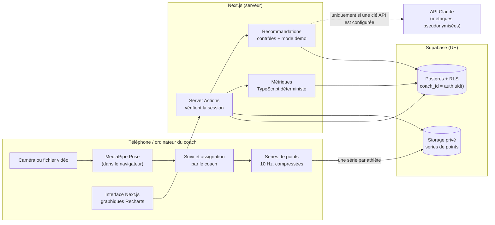

# Combat Coach IA

> Un smartphone sur trépied devient l'assistant du coach de sports de combat
> (lutte, MMA, jiu-jitsu brésilien, boxe).

L'app filme la séance, extrait le squelette de chaque athlète **dans le
navigateur**, puis produit des retours individuels (technique, physique,
prévention) et une vue d'ensemble du groupe. **Aucune vidéo n'est stockée** :
seules des séries de points articulaires quittent l'appareil.

**État du projet : les 8 phases de code sont terminées.** Reste la vidéo de démo
(voir la [feuille de route](#feuille-de-route)).

> Combat Coach IA n'est pas un dispositif médical. Les analyses sont des
> estimations issues du mouvement ; elles ne remplacent ni le jugement du coach
> ni l'avis d'un professionnel de santé.

## Ce qui fonctionne aujourd'hui

- Inscription, connexion et déconnexion du coach (e-mail + mot de passe).
- Schéma complet de la base avec Row Level Security : un coach ne voit que ses
  données.
- **Groupes** : création, modification, suppression, créneaux hebdomadaires,
  rattachement des athlètes.
- **Athlètes** : fiche (prénom ou pseudo, discipline, niveau, mesures
  facultatives), groupes, modification.
- **Consentement** : journal daté et non modifiable ; aucune analyse possible
  sans consentement enregistré ; consentement parental imposé pour un mineur.
- **Droit à l'effacement** : un bouton supprime la fiche et toutes les données
  liées, après confirmation par saisie du nom.
- **Séances** : création (groupe, date, type, durée), plusieurs séquences
  filmées par séance, suppression.
- **Capture** : caméra du téléphone ou vidéo de l'appareil (lue localement),
  squelettes en direct, conseils de cadrage, images analysées par seconde.
- **Assignation** : le coach touche un squelette et choisit l'athlète. Un athlète
  sans consentement apparaît mais ne peut pas être choisi.
- **Relecture avant envoi** : replay des squelettes seuls, réassignation,
  découpe et échange de deux athlètes confondus.
- **Envoi** : une série de points articulaires compressée par athlète
  (environ 20 Ko pour 20 secondes), jamais de vidéo.
- **Analyse** : 25 métriques déterministes (technique, physique, prévention,
  modules par discipline), chacune avec sa fiabilité de 0 à 1 et une
  explication en français. Seuls les athlètes avec un consentement valide au
  moment de l'analyse sont analysés.
- **Recommandations** : pour chaque athlète, 3 points forts, 3 axes
  d'amélioration priorisés, des exercices dosés, des signaux à vérifier et un
  plan pour la semaine, rédigés par Claude à partir des seules métriques.
  Chaque conseil affiche les métriques qui le justifient. Sans clé API : mode
  démonstration par règles simples, signalé comme tel.
- Tableau de bord avec compteurs et rappel des athlètes non analysables.
- Progression d'un athlète : une courbe par mesure, au fil des séances, avec
  un tableau texte équivalent. Seules les mesures de fiabilité ≥ 0,4 sont
  affichées. Le bilan donne l'écart entre première et dernière mesure, sans
  dire si c'est « mieux » : selon la mesure, plus haut peut être moins bien.
- Mode démo (tableau de bord, bouton « Charger la démo ») : trois groupes
  fictifs, douze athlètes (dont un mineur avec accord parental), neuf séances.
  Les squelettes sont synthétiques, mais les métriques passent par le même
  pipeline que les vraies séances. Tout porte le préfixe « Démo · » : c'est
  lui qui sert à effacer, donc évite de nommer une vraie fiche ainsi.
- Suivi de groupe (`/groups/[id]/suivi`) : liste des séances (athlètes
  analysés, signaux à surveiller) et moyenne par séance, calculée seulement sur
  les mesures fiables (≥ 0,7). Aucun texte généré : c'est du calcul pur.
  La synthèse rédigée par Claude pour le groupe (table `group_insights`) n'est
  pas encore branchée.
- CI : lint, types, tests et build à chaque push.

## Stack

| Brique | Choix | Pourquoi |
|---|---|---|
| Front + back | Next.js 16 (App Router), TypeScript | Un seul code pour mobile, tablette et PC |
| UI | Tailwind 4 + shadcn/ui | Composants accessibles, copiés dans le dépôt |
| Base, auth, stockage | Supabase (Postgres, région UE) | Palier gratuit, RLS native |
| Estimation de pose | MediaPipe Pose Landmarker « lite » (WebAssembly, GPU) | Tourne dans le navigateur, aucune image envoyée |
| Validation | Zod | Mêmes schémas côté formulaire et côté serveur |
| Rédaction des retours | API Claude (`@anthropic-ai/sdk`), Claude Haiku 5.5 par défaut, sortie JSON structurée | Coût : environ 0,2 centime par athlète |
| Tests | Vitest + PGlite | La RLS est testée dans un vrai Postgres embarqué, sans réseau |

## Démarrer en local

Prérequis : Node 24 et un compte [Supabase](https://supabase.com) gratuit.

1. **Installer**

   ```bash
   npm install
   ```

2. **Créer le projet Supabase** en région UE (Francfort ou Paris).

3. **Créer les tables** : dans Supabase, ouvrir *SQL Editor* et exécuter, dans
   l'ordre, le contenu de :
   - `supabase/migrations/20261116000001_initial_schema.sql`
   - `supabase/migrations/20261116000002_pose_storage.sql`
   - `supabase/migrations/20261116000003_consent_journal.sql`
   - `supabase/migrations/20261117000004_pose_clips.sql`
   - `supabase/migrations/20261117000005_athlete_analysis.sql`

4. **Renseigner les clés** : copier `.env.example` vers `.env.local`, puis y
   coller l'URL du projet et la clé publique (*publishable key*). Ne jamais y
   mettre la clé secrète.

5. **(Facultatif) Clé API Claude** : ajouter `ANTHROPIC_API_KEY` dans
   `.env.local` (et dans les variables d'environnement Vercel) pour des
   recommandations rédigées par l'IA. Sans clé, l'app utilise le mode
   démonstration. `ANTHROPIC_MODEL` permet de changer de modèle.

6. **Autoriser l'URL locale** : dans *Authentication > URL Configuration*,
   mettre `http://localhost:3000` en *Site URL* et ajouter
   `http://localhost:3000/**` aux *Redirect URLs*.

7. **Lancer**

   ```bash
   npm run dev
   ```

Sans `.env.local`, l'app démarre quand même et affiche un message
d'installation sur la page de connexion.

## Commandes

| Commande | Rôle |
|---|---|
| `npm run dev` | Serveur de développement |
| `npm test` | Tests unitaires et tests RLS |
| `npm run test:coverage` | Tests + couverture (90 % minimum exigé sur les métriques et la pose) |
| `npm run typecheck` | Vérification des types |
| `npm run lint` | ESLint |
| `npm run check` | Lint + types + tests (à lancer avant un commit) |
| `npm run build` | Build de production |
| `npm run e2e` | Tests de bout en bout (Playwright, Chromium ; `npx playwright install chromium` la première fois) |

## Architecture



La vidéo ne sort jamais du navigateur. Le serveur ne voit que des séries de
points, puis des métriques et des textes pseudonymisés.

Arborescence :

```
src/
  app/
    page.tsx              page d'accueil publique
    (auth)/               connexion, inscription
    (app)/                pages réservées au coach connecté
      dashboard/          tableau de bord
      groups/             liste, création, fiche et modification d'un groupe
      athletes/           liste, création, fiche et modification d'un athlète
      sessions/           séances, séquences, écran de capture
    auth/callback/        retour du lien de confirmation par e-mail
  components/             composants d'interface (ui/ = shadcn)
    form/                 champs de formulaire partagés
    roster/               formulaires groupe, athlète, consentement, effacement
    sessions/             formulaire et badge de séance
    capture/              moteur MediaPipe, boucle en direct, replay, relecture
    metrics/              bouton d'analyse et rapport par athlète
    insights/             bouton de rédaction et affichage des recommandations
  lib/
    auth/                 schémas Zod, Server Actions, coach courant
    roster/               groupes et athlètes : types, validation, lectures, actions
    sessions/             séances et séquences : types, validation, lectures, actions
    pose/                 cœur de pose, sans React : suivi, identités, enregistrement,
                          corrections, format de fichier, squelette paramétrable
    metrics/              calcul des métriques (TypeScript pur, déterministe),
                          modules par discipline, affichage
    insights/             recommandations : contexte pseudonymisé, consignes,
                          schéma de sortie, contrôles, appel Claude, mode démo
    security/csp.ts       serveurs que la page a le droit de contacter
    supabase/             clients navigateur / serveur / proxy
    i18n/fr.ts            tous les textes de l'interface
    routes.ts             règles d'accès par chemin
  proxy.ts                rafraîchit la session et redirige (ex-middleware)
supabase/migrations/      schéma SQL et politiques RLS
tests/db/                 tests de sécurité de la base
e2e/                      tests de bout en bout (Playwright)
docs/                     pitch, posts et affiche pour la salle
```

### Sécurité des données

La protection ne repose pas sur le code de l'app mais sur Postgres :

1. Chaque table porte un `coach_id`, et la politique RLS est partout la même :
   `coach_id = auth.uid()`.
2. Les clés étrangères sont composites `(id, coach_id)` : un coach ne peut pas
   rattacher une de ses lignes à l'objet d'un autre coach.
3. Supprimer un athlète efface en cascade toutes ses données (droit à
   l'effacement).
4. Un athlète sans consentement enregistré a `analysis_allowed = false` : c'est
   le comportement par défaut, ce qui couvre le cas des mineurs.
5. Le statut de consentement ne s'écrit pas directement : il faut ajouter une
   ligne au journal `consents`, et un trigger reporte le statut sur l'athlète.
   Le journal lui-même est en ajout seul (ni modification ni suppression).
6. Un athlète dont la date de naissance indique moins de 18 ans ne peut pas
   recevoir un consentement « adulte » : la base le refuse.

7. La base refuse d'enregistrer la pose d'un athlète sans consentement valide,
   même si l'app se trompait.

Ces points sont vérifiés par `tests/db/rls.test.ts`, qui exécute les vraies
migrations dans PGlite (Postgres en WebAssembly).

### Ce qui quitte l'appareil pendant une capture

| Quoi | Vers où | Contenu |
|---|---|---|
| Moteur et modèle de pose (téléchargés une fois) | cdn.jsdelivr.net, storage.googleapis.com | Rien n'est envoyé, on télécharge |
| Séries de pose des athlètes désignés | Supabase (UE), bucket privé | Points articulaires compressés |
| Métriques pseudonymisées (depuis le serveur, si une clé API est configurée) | API Claude (Anthropic) | Valeurs formatées, niveau, discipline, « adulte / mineur » : ni prénom, ni date de naissance, ni identifiant |
| Vidéo | **Nulle part** | Elle reste dans le navigateur |

MediaPipe envoie par défaut des statistiques d'usage à Google
(`odml.pa.googleapis.com`), sans option pour les couper. La politique de
sécurité de l'app (`connect-src`, dans `next.config.ts`) n'autorise que les
serveurs du tableau ci-dessus : le navigateur bloque ces envois.

## Pipeline de capture

```
caméra ou fichier ──► MediaPipe (25 points par personne, 30-60 images/s)
                         │
                         ▼
                  suivi des personnes (boîtes englobantes + distance)
                         │
                         ▼
                  identités : assignation au toucher par le coach
                  (+ réattribution prudente après une occlusion, marquée « à vérifier »)
                         │
                         ▼
                  enregistrement à 10 Hz ──► relecture et corrections
                         │
                         ▼
                  par athlète : quantification 16 bits + différences + gzip
                         │
                         ▼
                  Supabase Storage  <coach>/<séance>/<séquence>/<athlète>.bin
```

## Métriques

Calcul en TypeScript pur (`src/lib/metrics`), côté serveur, sur les séries de
pose uniquement. **Aucun modèle de langage n'intervient dans les calculs.**

1. `features.ts` : pour chaque image, angles, distances et vitesses. Une
   valeur n'est calculée que si tous ses points ont une visibilité d'au moins
   0,5 ; une image dont la visibilité moyenne est sous 0,4 est ignorée.
2. `analyze.ts` : agrégation (médiane, centiles, amplitude, fréquence
   d'événements) et fiabilité.
3. `disciplines.ts` : métriques et seuils par sport. C'est le seul fichier à
   modifier pour ajuster une discipline.

| Catégorie | Métriques |
|---|---|
| Technique | largeur d'appuis, hauteur de garde, flexion des genoux et des hanches, inclinaison du tronc, centrage sur les appuis |
| Physique | intensité (m/s), explosivité, variabilité du rythme, baisse d'intensité et garde qui baisse (indicateurs de fatigue), amplitudes genoux / hanches / épaules |
| Prévention | genou qui rentre (valgus), flexion du tronc prononcée, coude verrouillé en frappe, asymétrie gauche/droite |
| Lutte, judo, MMA | niveau de garde, changements de niveau par minute, temps au sol |
| Boxe, kickboxing, MMA | frappes par minute, garde baissée, temps de retour en garde, rotation du tronc |
| JJB | temps au sol, avec avertissement sur la fiabilité |

**Fiabilité** (0 à 1) = visibilité moyenne des points utilisés × assez
d'images (5 s, ou 30 s pour les amplitudes et l'asymétrie) × (0,5 + 0,5 × part
des images exploitables), × 0,85 si la métrique dépend de la profondeur
estimée. L'interface affiche « fiable » à partir de 0,7, « à confirmer » de 0,4
à 0,7, « peu fiable » en dessous, et toujours « ≈ » devant une valeur.

**Signaux « à surveiller »** : seulement si la valeur dépasse un seuil de
vigilance ET que la fiabilité est d'au moins 0,5. Ce sont des signaux à
vérifier avec un professionnel, jamais des diagnostics.

**Tests** : un squelette 3D paramétrable (`src/lib/pose/skeleton.ts`) produit
des poses à angles connus ; les métriques les retrouvent à ±2°, que l'athlète
soit face à la caméra, de trois quarts ou de profil.

**Non mesuré, volontairement** : le dos arrondi (aucun point sur la colonne :
on mesure la flexion du tronc à la place) et l'hyperextension de l'épaule (pas
de repère fiable en 2D).

## Recommandations

Le modèle **rédige**, il ne calcule rien : il reçoit des valeurs déjà
formatées (« ≈ 128° ») avec leur fiabilité (`src/lib/insights/context.ts`).

Garde-fous, du plus fort au plus souple :

1. **Schéma construit par athlète** (`schema.ts`) : les métriques citables
   forment une énumération de ses seules mesures fiables. Avec la sortie
   structurée de l'API, le modèle ne peut pas citer une métrique absente ; la
   réponse est revalidée côté serveur avec le même schéma Zod.
2. **Mesures peu fiables** (fiabilité sous 0,4) : jamais envoyées avec leur
   valeur, seulement leur nom, pour que le modèle dise qu'elles manquent.
3. **Contrôles métier** (`validate.ts`) : toute mesure « à confirmer » citée
   doit être déclarée comme telle ; alertes seulement sur les mesures
   signalées ; pas de vocabulaire médical (diagnostic, pathologie, nom de
   blessure) ; pas de note chiffrée ni de jugement dévalorisant.
4. Réponse refusée : une seconde tentative avec la liste des problèmes, puis
   abandon (rien n'est enregistré).
5. À l'écran, chaque conseil liste les métriques qui le justifient et la
   mention « à relire par le coach » accompagne toujours le texte.

Retirer un consentement efface aussi les recommandations déjà rédigées.

On garde 25 des 33 points de MediaPipe : les yeux et la bouche sont retirés,
le nez et les oreilles suffisent pour situer la tête. Le format de fichier est
décrit en tête de `src/lib/pose/codec.ts`.

## Feuille de route

- [x] **1. Fondations** : Next.js, Supabase, auth, schéma, RLS, CI
- [x] **2. Groupes et athlètes** avec consentements et effacement
- [x] **3. Capture caméra**, pose en direct, assignation manuelle, replay
- [x] **4. Pipeline de métriques** déterministe, testé avec des fixtures à angle connu
- [x] **5. Recommandations via l'API Claude** : sortie JSON validée, citations des métriques, mode démo
- [x] 6. Tableaux de bord athlète et groupe : progression par mesure, suivi de groupe
- [x] 7. Mode démo : données fictives générées par le vrai pipeline, effaçables d'un clic
- [x] 8. Documentation, schéma d'architecture, tests de bout en bout, pitch et affiche
- [ ] Vidéo de démo et GIF (à enregistrer sur un vrai téléphone)

## Limites connues

- L'estimation de pose 2D souffre de l'occlusion en combat (clinch, sol). Chaque
  métrique portera un score de confiance, et les images peu fiables seront
  ignorées.
- Le travail au sol (JJB) est très difficile avec une seule caméra : la v1 se
  limitera à des métriques robustes.
- La fatigue et l'intensité seront des estimations à partir du mouvement, pas
  des mesures physiologiques.
- **4 athlètes maximum dans le cadre** recommandés, à 4 à 6 m de la caméra.
  Au-delà, ou plus loin, la détection devient peu fiable.
- Le suivi peut échanger deux athlètes qui se croisent ou s'accrochent : la
  relecture permet de corriger avant l'envoi.
- Une séquence dure 10 minutes au plus. Pour une séance entière, enchaîner
  plusieurs séquences.
- Les seuils de vigilance et les métriques sont des heuristiques raisonnables,
  pas des normes validées scientifiquement. Comparer un athlète à lui-même dans
  le temps a plus de sens que la valeur absolue.
- Les coordonnées 3D sont une estimation de MediaPipe à partir d'une seule
  caméra : la profondeur est bruitée.
- Avec un cadrage en buste (jambes hors champ), les métriques des jambes ne
  sont pas calculées et l'app l'indique.
- Retirer un consentement efface les résultats d'analyse ; les séries de
  mouvement restent jusqu'à « Effacer toutes les données ».
- Recommandations : testées avec un faux client (tous les cas, sans clé) et
  en mode démonstration dans le navigateur ; la qualité rédactionnelle réelle
  de Claude sur ces consignes reste à évaluer avec une clé API.
- Performances mesurées pour l'instant sur ordinateur (Chrome, 44 à 60 images
  analysées par seconde). Pas encore mesurées sur téléphone.
